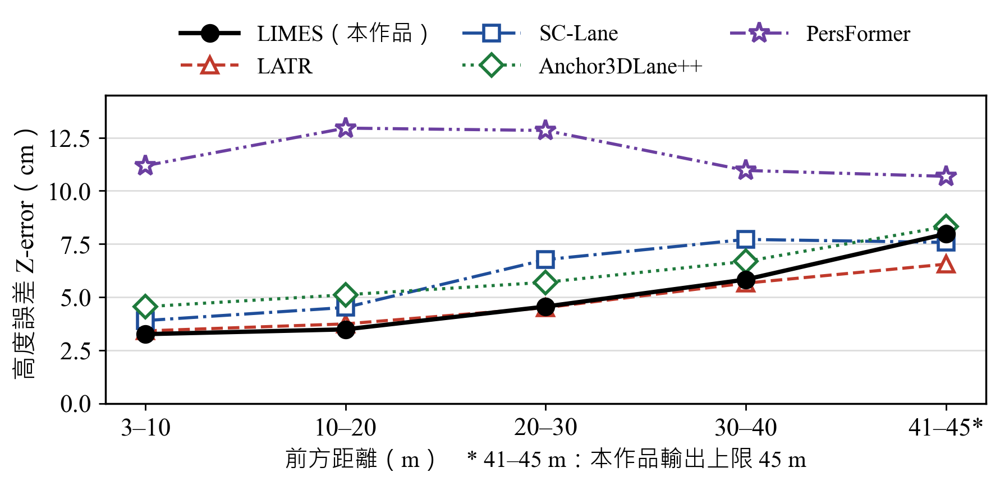
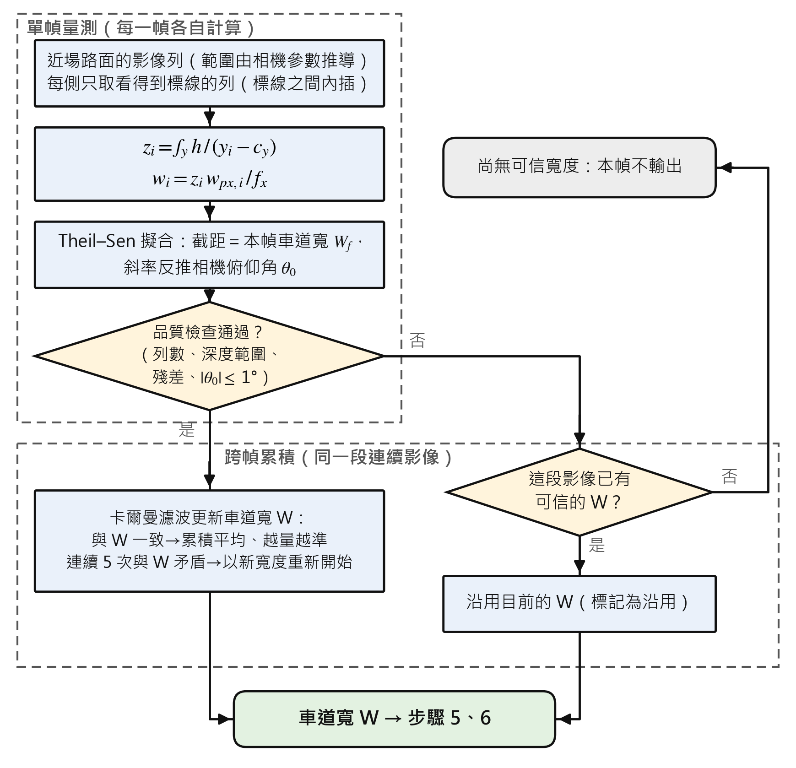

# LIMES：車道寬度自校正之單目道路高程與坡度估測

**LIMES: Lane-width-Informed Monocular Elevation Sensing for Road Profiling** · [English (technical details)](README.en.md)

只用一台前方攝影機，估出車子前方**數公尺到 45 m 路面的高低起伏與坡度**。不用光達、不用雙鏡頭，也不需要 3D 標註資料來訓練。

做法的核心只有一句話：**把車道寬度當成尺。** 車道的實際寬度大致固定，所以影像中車道看起來多寬，就代表那裡離車子多遠；知道了每一列路面的距離，再看它在畫面中的高低位置，就能換算出路面的高度。

---

## 成果一覽

在 OpenLane 真實道路資料集的上下坡路段，和四個近年發表的學習式 3D 車道方法比較：

| 方法 | 近段高度誤差（3–40 m） | 遠段高度誤差（41–45 m） | 有預測的幀 |
|---|---|---|---|
| **LIMES（本作品）** | **4.24 cm** | 8.02 cm | 79.4 % |
| LATR（ICCV 2023） | 4.41 cm | **6.60 cm** | 99.4 % |
| SC-Lane（ICCV 2025） | 5.59 cm | 7.64 cm | 95.2 % |
| Anchor3DLane++（TPAMI 2025） | 5.84 cm | 8.26 cm | 91.6 % |
| PersFormer（ECCV 2022） | 12.77 cm | 10.70 cm | 99.5 % |

<p align="center"></p>

- **高度誤差**（Z-error）＝預測的路面高度和真值差多少公分，越小越好。比較只用「五個方法都有預測」的 918 幀、同一批點。LIMES 只輸出到 45 m，所以遠段只比到 45 m。
- **近處和最好的學習式方法同一水準，遠處較差**；坡度誤差近段 0.23°（LATR 0.24°）。
- **不需要 3D 標註**：只有 2D 車道線偵測器是學出來的，其餘全部是投影幾何。四個對照方法都要用帶 3D 高度的標註訓練。
- **快**：在 GTX 1650 筆電顯卡上每幀約 0.1 秒，對照方法約 0.3–0.8 秒。
- **為什麼要自己量車道寬**：若改成固定車道寬 3.6 m，近段誤差從 4.8 cm 變成 23.3 cm。這裡算的是 LIMES 自己所有有預測的幀，不限五方共同的 918 幀，所以基準是 4.8 cm，不是表中的 4.24 cm。
- 在 CARLA 模擬器的三條路線（路面高度真值直接取自模擬器）上，近段高度誤差約 2–3 cm。

> ⚠ 這些參數是在上面這批資料上開發的，限制見[下面](#已知限制)。

---

## 名詞

| 名詞 | 意思 |
|---|---|
| 高度剖面 | 沿著前方距離，路面比車子底下高或低多少，畫成一條曲線 |
| 自車道 | 車子目前所在的車道；它左右兩條線就是量寬度用的「尺」 |
| 近場 | 車子正前方最近、看得到路面的一小段（OpenLane 相機約 8–10 m），在這裡把路面當成平的 |
| 列 | 影像中的一橫排像素。越上面的列，對應的路面越遠 |
| $f_x$、$f_y$、$c_y$、$h$ | 相機的水平／垂直焦距（像素）、影像中心的列、相機離地高度（公尺），都是相機出廠或安裝時就知道的數字 |
| Theil–Sen | 一種穩健的直線擬合：取所有兩點斜率的中位數，少數錯誤點拉不動它 |
| 卡爾曼濾波 | 把一段影片中每一幀的量測依可信程度加權平均，越量越準 |
| OpenLane | Waymo 行車影像加上 3D 車道線標註的公開資料集，用來評估 |
| CARLA | 開源的自駕車模擬器，路面高度真值精確，用來驗證幾何 |
| CLRNet | 一個 2D 車道線偵測模型（CVPR 2022），本作品拿它在 OpenLane 的 2D 標註上微調後使用 |

---

## 原理

相機看前方路面，車道兩條線在影像中越往上（越遠）靠得越近。若車道的實際寬度是 $W$，某一列兩條線相距 $w_{px}(y)$ 像素，針孔相機模型直接給出那一列的距離和高度：

$$z = \frac{f_x \, W}{w_{px}(y)} \qquad Y = -\frac{z\,(y - c_y)}{f_y}$$

- $z$：那一列路面離相機多遠（公尺）。
- $Y$：那一列路面相對相機的高度。路是平的時候，每一列的 $Y$ 都等於 $-h$；遠處路面「抬起來」或「沉下去」，$Y$ 就跟著變。

把每一列的 $(z, Y)$ 連起來，就是前方路面的高度剖面。對它做局部的穩健擬合，得到每個距離上的坡度。

**難點在 $W$。** 實際的車道寬隨道路不同，從 3.0 m 到 5 m 以上都有，而 $z$ 和 $W$ 成正比：寬度錯 10 %，距離和高度就跟著錯 10 %。所以 LIMES 不預設車道寬，而是**每一幀自己量**：車子正前方的近場可以當成平的，再加上已知的相機高度 $h$，近場每一列的距離是 $z = f_y h / (y - c_y)$，車道寬就能直接量出來。一段影片中的量測再用卡爾曼濾波累積起來。

<p align="center"></p>

---

## 流程


| 步驟 | 做什麼 | 為什麼 |
|---|---|---|
| ② 車道線 | CLRNet 偵測整條車道線；挑最靠近車子的左右一對，近處寬度要在 2.5–4.5 m 之間，過寬但遠近保持平行的視為真正的寬車道 | 選錯線，尺就錯了 |
| ③ 標線證據 | 在影像上檢查每一列是否真的有一條亮的漆線。兩條都是實線時，把線位置貼齊漆線中心。兩條線的深度突然跳開的地方在這裡就截斷（坡頂後面被擋住的路段不接上來），後面的量寬和剖面都不用截掉的部分 | 偵測器在虛線間隙、被車擋住時會「猜」線的位置，猜的位置不能拿來當尺 |
| ④ 量寬 | 每一側只取近場裡真的看到漆的列（漆列之間內插），每列各量一個寬度，Theil–Sen 擬合取截距當本幀寬度；擬合斜率反推相機俯仰，超過 1° 代表近場不平，這幀的量測不採用 | 平地假設只在近場成立；在坡度轉折處量會量錯 |
| ⑤ 剖面 | 用上面的公式算每一列的 $(z, Y)$，再做局部穩健擬合得到高度和坡度 | |
| ⑥ 檢查 | 線對自己的寬度和正在用的寬度差超過 30 % 不輸出；前方車道開始變寬（例如路口前多出轉彎車道）的地方之後截斷 | **寧可不輸出，也不輸出錯的**：前方變寬在影像上和上坡長得很像 |

---

## 已知限制

- **約兩成的幀不輸出。** 大多是只偵測到一側車道線（約 78 %），其次是線對寬度不合理、影片開頭還沒量到寬度。
- **遠處比 LATR 差。** 30 m 以後誤差上升較快；遠處一個像素代表的距離很大，車道寬的小誤差會被放大。
- **假設前方車道寬不變。** 路口前多出轉彎車道、匝道合流，會被讀成坡度。步驟 ⑥ 的變寬截斷只擋得掉一部分。
- **參數是在開發資料上調的，換一批路段就落後 LATR。** 開發用的是 OpenLane 上下坡子集、兩組隨機挑的 OpenLane 路段和 CARLA。在那兩組隨機路段上，近段已經落後 LATR 2.5–3.5 cm，主要發生在前方車道變寬的地方。另外依起伏挑出、沒參與開發的坡道路段上差距更大（LATR 約 4.2 cm，LIMES 約 9.9 cm），主因是寬車道上車道寬量錯。

---

## Repo 裡有什麼

```text
libs/inference/
├── pipeline_clrnet.py      ★ 現行流程（步驟 ①–⑥）
├── lane_detector.py          CLRNet 包裝
├── model_lane_fitting.py     挑自車道線對、逐列曲線
├── paint_evidence.py         標線證據（這一列有沒有漆）
├── pitch_estimation.py       近場量寬、卡爾曼、深度與高度、剖面
├── widening.py               前方車道變寬的截斷
├── geometry.py               針孔相機模型
└── pipeline.py 等            早期的 ELSED 前端（見下）
config/                       兩份設定檔，每個數字旁邊都寫了來源
openlane_module/              OpenLane 轉成本專案格式、官方評估、高度誤差評估
baselines/                    四個對照方法（LATR、SC-Lane、Anchor3DLane++、PersFormer）的本機推論
carla_module/                 CARLA 資料採集與幾何驗證
tests/                        單元測試（純幾何，約 2 秒，不需要影像或 GPU）
```

**兩個前端。** 專案一開始用的是傳統影像處理：PIDNet 道路分割 → ELSED 線段偵測 → 自己寫的車道線追蹤（`pipeline.py`、`line_segmentation.py`、`lane_segmentation.py`、`lane_fitting.py`）。後來換成 CLRNet 偵測整條車道線，抓到率明顯較高，這就是現行的 `pipeline_clrnet.py`。兩者的後半段（量寬、剖面）是同一份程式。`utils/` 底下的單張／批次 runner 目前仍走 ELSED 流程；CLRNet 流程從 `openlane_module/zerror_predict.py` 執行。

**不在 repo 裡的東西：**

| 東西 | 原因／取得 |
|---|---|
| OpenLane 影像與標註 | 授權（CC BY-NC-SA＋Waymo 非商業）禁止轉散布，請自[官方](https://github.com/OpenDriveLab/OpenLane)下載 |
| CLRNet 原始碼與權重（含在 OpenLane 上微調的權重） | 放在 repo 外，路徑由環境變數 `CLRNET_ROOT` 指定 |
| PIDNet 預訓練權重 | ELSED 流程用，見英文 README 的安裝步驟 |
| CARLA 採集的資料集 | 檔案大；用 `carla_module/get_carlaDataset.py` 重新採集 |
| 四個對照方法的原始碼與權重 | 公開下載，`baselines/*/README.md` 寫了來源與指令 |
| 參考論文全文 | 版權屬原出版者 |

安裝與執行的完整步驟、每個設計決定背後的實測數據，在 [README.en.md](README.en.md)。

---

## 專案沿革

- 2026 年 3–6 月：與同學共同開發的雛形（[wiwihuang-cs/mono3D-two-plane-geo](https://github.com/wiwihuang-cs/mono3D-two-plane-geo)），把路面當成近、遠兩個平面估坡度。
- 6 月起：改成連續的高度剖面、建立 CARLA 與 OpenLane 的評估、車道寬自校正、換成 CLRNet 前端、與四個學習式方法比較。repo 在 10 月由 `mono3D-two-plane-geo` 改名為 `lane-width-road-elevation`。
